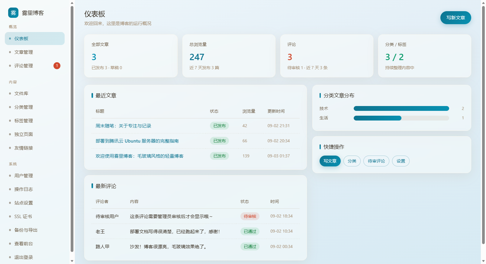

# Fog Blog · 毛玻璃风格轻量博客

[](https://opensource.org/licenses/MIT) [](https://www.python.org/) [](https://flask.palletsprojects.com/)

基于 **Flask + SQLite** 的轻量博客系统，前台采用半透明毛玻璃（Glassmorphism）设计，自带完整管理后台。零外部 CDN 依赖、单文件数据库、原生 HTML/CSS/JS，无需单独安装数据库服务，适合个人博客的本地体验和自行部署。

## 截图



后台提供文章、浏览量、评论及分类统计，并展示最近文章与待审核评论。这是附件提供的演示截图，不是本次测试生成的结果。含外部背景插画的前台和设置截图保留在本地，未纳入公开版本。

## 功能一览

| 模块 | 功能 |
| --- | --- |
| 内容创作 | Markdown / HTML 双模式编辑器（可互转）、行内预览 / 分屏 / 全屏、撤销重做、字数统计、目录（TOC）、emoji 面板、定时发布、文章置顶、**自动保存草稿**（防抖 1.2s + 浏览器本地缓存 + 恢复条） |
| 文件系统 | 集中文件库（图片 / 文档 / 视频 / 音频 / 压缩包，应用请求上限 200MB；Nginx 模板默认 50MB）、编辑器内拖拽 / 粘贴上传、文章直接引用 `/uploads/<kind>/<file>` |
| 内容管理 | 分类、标签、时间归档、独立页面、友情链接、自定义导航、**回收站**（30 天自动清理 / 手动恢复 / 永久删除）、**文章批量管理**（勾选批量移入回收站 / 永久删除 / 批量恢复）、排序（时间 ↓↑ + 热度 🔥 = 点赞×5 + 评论×10 + 阅读） |
| 互动评论 | 自建评论 + 审核、游客免注册评论（**按 IP 自动派生稳定昵称**）、浏览统计（session 去重）、点赞、留言板、文章级评论开关、**中央确认弹窗**（自定义毛玻璃，用于多处删除和批量操作）|
| 用户系统 | 仅后台管理员账号（不开放前台注册），游客可直接评论；后台账号管理（启用 / 停用 / 重置密码 / 删除） |
| 主题体验 | 5 套毛玻璃配色（amber / sea / mint / grape / rose，浅深双调）、**前后台配色 / 深浅色实时双向同步**（server 权威）、前台访客自选配色、深色模式（手动 / 定时 / 跟随系统）、**自定义背景图**（jpg/png/webp/gif + 透明度可调）、**首页开屏动效**（毛玻璃 + 光晕 + 漂浮文章卡片，24h 内不重复） |
| PDF 阅读 | **PDF 转文章**：上传 PDF 即可生成文章页，前台用内置 PDF.js **无感连续滚动阅读**（保留原版式、加载进度、逐页淡入、单页重试、懒渲染，实际表现取决于文档与浏览器）；或提取文字转为 Markdown 草稿 |
| 侧栏组件 | 博主信息卡、每日鸡汤、免费天气（IP 定位，无需 API Key）、人生倒计时 |
| 搜索与 SEO | 全文搜索、RSS、sitemap.xml、robots.txt、相关文章、代码高亮 |
| 系统管理 | 仪表板、站点设置、操作日志（自动清理）、数据备份（下载 DB + JSON 导出）、**SSL 证书后台上传**（宝塔式：粘贴 PEM → 自动解析校验 → 写 `/etc/nginx/ssl/<域>/` + nginx -t + reload，失败处理与证书备份 + 过期前 30 天提醒；真实生效未实机验证） |

## 快速开始

要求：Python 3.9+，无需数据库服务（SQLite 单文件）。

```bash
# 1. 克隆并进入
git clone https://github.com/throw29/fog-blog.git
cd fog-blog

# 2. 创建虚拟环境并安装依赖
python -m venv .venv
source .venv/bin/activate        # Linux / macOS
# Windows PowerShell: .\.venv\Scripts\Activate.ps1
python -m pip install -r requirements.txt

# 3. 初始化演示数据（建库 + 分类/标签 + 3 篇演示文章 + 管理员）
python seed.py

# 4. 启动
python app.py                     # 或 flask --app app run --debug

# 浏览器打开
#   前台 http://127.0.0.1:5000
#   后台 http://127.0.0.1:5000/admin
```

**初始管理员**：用户名为 `admin`，首次执行 `seed.py` 时随机生成密码并在终端显示。请妥善保存并及时修改；已有账号不会被重置。可用 `BLOG_ADMIN_PASSWORD` 环境变量指定初始密码。

应用读取 `BLOG_SECRET_KEY`；未设置时使用进程内随机密钥，仅适合本地体验，重启会使已有会话失效。生产环境必须设置持久随机密钥，所有 worker 使用同一个值。

> 不想用演示数据？手动初始化：
> ```bash
> flask --app app init-db                    # 建库
> flask --app app create-user admin 你的密码  # 建管理员
> ```

## 目录结构

```
blog/
├── app.py            # 应用入口（flask / gunicorn 启动，含 CLI 命令）
├── config.py         # 配置（数据库、上传限制、站点默认设置）
├── models.py         # 数据模型
├── utils/            # common.py 通用工具、ssl_manager.py 证书管理
├── routes/
│   ├── main.py       # 前台页面 + RSS / sitemap / robots
│   ├── auth.py       # 后台管理员登录 / 登出
│   ├── admin.py      # 后台管理（文章/分类/评论/文件库/账号/日志/设置/PDF 转文章）
│   ├── api.py        # 评论 / 点赞 / 上传 / 天气等接口
│   └── member.py     # 已下线读者入口的兼容重定向
├── templates/        # 前台 + 后台模板（Jinja2）
├── static/
│   ├── css/          # style.css / theme.css / palette.css / admin.css
│   ├── js/           # editor.js / theme.js / widgets.js
│   └── vendor/       # 本地化第三方库：marked / turndown / highlight.js / pdf.js（无 CDN）
├── deploy/           # Ubuntu 部署脚本和 systemd / Nginx 模板
├── screenshots/      # 演示截图
├── THIRD_PARTY_NOTICES.md  # 第三方库许可证说明
├── RELEASE_CHECK.md  # 本地发布检查记录
├── uploads/          # 上传文件（运行时生成，按类型分子目录）
├── backup/           # 数据库备份目录（运行时自动创建）
├── blog.db           # SQLite 数据库（首次初始化生成，不入库）
├── seed.py           # 演示数据脚本
├── smoke.py          # HTTP 冒烟测试
└── e2e_features.py   # 端到端回归测试
```

## Ubuntu 服务器部署

> **项目提供部署脚本与模板**，详见 [`deploy/README.md`](deploy/README.md)：
> ```bash
> git clone https://github.com/throw29/fog-blog.git /var/www/blog
> cd /var/www/blog
> sudo bash deploy/install.sh    # 自动：venv + 依赖 + 随机 BLOG_SECRET_KEY + systemd + Nginx
> ```

部署脚本目标为 Ubuntu，采用 Nginx 反代 + Gunicorn + systemd。脚本会安装系统包、复制目录并修改服务配置，执行前审查脚本并备份已有部署。本次仅验证脚本语法，未在 Ubuntu 实机执行安装或测量内存占用。Windows 本地运行使用 Flask，不使用 Gunicorn。

### 手动部署要点

```bash
# 1. 安装系统依赖
apt update && apt install -y python3 python3-venv python3-pip nginx git

# 2. 安装项目依赖
cd /var/www/blog
python3 -m venv venv && source venv/bin/activate
pip install -r requirements.txt

# 3. 初始化 + 建管理员（不要用默认密码！）
flask --app app init-db
flask --app app create-user admin 你的强密码

# 4. 设置随机密钥（务必执行，否则 session 不安全）
python3 -c "import secrets; print('BLOG_SECRET_KEY=' + secrets.token_hex(32))"
# 输出写入 systemd 服务文件的 Environment= 行

# 5. 配置 systemd 服务 + Nginx 反代（见 deploy/blog.service 与 deploy/nginx.conf）
# 6. 申请 HTTPS（certbot --nginx 或云厂商免费证书）
```

常用维护：

```bash
systemctl restart blog                          # 重启
journalctl -u blog -f                           # 看日志
cd /var/www/blog && git pull && systemctl restart blog   # 更新
flask --app app create-user 新用户 密码          # 加管理员
```

### HTTPS：后台上传 SSL 证书

后台「SSL 证书」页支持像宝塔面板一样粘贴证书与私钥，通过已部署的特权 wrapper 校验并应用；真实 Nginx 写盘和 reload 尚未实机验证：

1. 用任意方式取得证书（`certbot --nginx -d 你的域名`、云厂商免费证书、商业证书均可），下载 **nginx 格式**的 `fullchain.pem`（含中间证书）与 `privkey.pem`。
2. 登录后台 → 侧栏「SSL 证书」→「上传 / 更新证书」，粘贴域名 + 证书 + 私钥，点「校验并生效」。
3. 后端自动完成：PEM 解析 → **证书与私钥配对校验** → **域名必须在证书 SAN/CN 内** → 有效期检查 → 写入 `/etc/nginx/ssl/<域名>/` → 生成 HTTPS server block → `nginx -t` → 自动 reload。应用前会写盘并进行 Nginx 检查，现有失败处理不保证配置和软链全部回滚；首次启用前请备份。旧证书备份在 `/etc/nginx/ssl/<域名>/.backup/`。

- 停用：状态页「停用 HTTPS」即回退 HTTP（证书文件保留）。
- 更新：再传一份新证书即覆盖旧配置；历史记录保留最近 20 条，过期前 30 天状态页会提示。
- 依赖 `deploy/install.sh` 部署的 sudo 白名单 wrapper（`/usr/local/bin/blog-ssl-apply`，为 www-data 配置限定命令的 sudo 权限，负责证书和 Nginx 配置写入及 reload），私钥通过 stdin 传入、不落命令行。
- 本地开发 / CI 无 wrapper 时，设置 `BLOG_SSL_DRY_RUN=1` 即只做解析与校验、不写盘（e2e 测试即此模式）。

## 常见问题

**Q: 评论为什么不显示？**
后台「设置」开启审核后，新评论需在后台「评论管理」点击「通过」。管理员评论直接显示。

**Q: 定时发布怎么生效？**
发布时选择「定时发布」并设置未来时间，任意页面请求会自动触发发布，无需额外任务调度。

**Q: 前台注册能不能开？**
本系统不开放前台注册：仅「后台账号」一种身份，游客免登录即可评论（昵称按 IP 自动派生，可自行修改，邮箱选填）。

**Q: 访客昵称是怎么生成的？**
根据访客 IP + `SECRET_KEY` 做 md5 哈希派生稳定昵称（同一 IP 始终同名），盐来自应用密钥；该派生机制不代表对 IP 隐私的绝对保证。可手动改。

**Q: PDF 转文章两种模式区别？**
- **在线阅读（推荐）**：保留原版式，前台 PDF.js 在浏览器端渲染，扫描版 PDF 也可用于在线阅读。
- **转文字草稿**：pypdf 提取文字成 Markdown 草稿，可完全编辑（图表排版会丢失）。

**Q: 几百页的大 PDF 会卡吗？**
PDF 阅读采用 IntersectionObserver 懒渲染，优先渲染可见页和附近页面。实际速度和内存占用取决于 PDF、浏览器及设备，尚未进行统一性能测试。

**Q: 侧栏天气需要 API Key 吗？**
不需要。后端代理调用 `api.ip.sb` → `ip-api.com` → `wttr.in` 免费接口，IP 定位 + 城市内存缓存。内网环境无法定位时可后台设置「天气默认城市」。

**Q: 深色模式怎么配置？**
后台「站点设置 → 主题」：默认外观、自动切换（关闭 / 定时 / 跟随系统）、时段、正文深色字自动反色。

**Q: 忘记管理员密码？**
已有管理员可在后台「用户管理」重置其他账号的密码。`create-user` 只创建新账号，不重置已有账号；请勿依靠删除账号来恢复密码。

**Q: 数据备份与恢复？**
后台「备份与导出」可下载 SQLite 数据库文件。恢复：停服务 → 替换 blog.db → 启动。

**Q: 换主色调？**
后台「站点设置 → 外观配色」下拉切换 5 套配色（amber 默认）。定义在 `static/css/palette.css`，可复制 block 自定义。访客也可在前台导航「调色板」按钮自选（存 localStorage，不影响他人）。

**Q: 想要动漫壁纸做博客背景（毛玻璃透出背景图）？**
后台「站点设置 → 自定义背景图」：粘贴图片 URL 或点「上传图片」直接传本地壁纸（jpg/png/webp/gif），再用滑杆调背景图透明度（5-100%，默认 35）。保存后前台全屏铺图：文章卡片 / 导航 / 页脚仍是毛玻璃，背景图从玻璃后透出；越淡越素净利阅读、越浓玻璃透出的图越明显。留空即恢复默认渐变底 + 漂浮光斑。设置项：`site_bg_image` / `site_bg_opacity`。

**Q: 文章列表怎么排序？写一半被关掉会不会丢稿？**
后台「文章管理」筛选条右侧可切换：发布时间 ↓ / 发布时间 ↑ / 热度 🔥（点赞×5 + 评论×10 + 阅读），可与「全部 / 已发布 / 草稿 / 定时」组合使用。写文章时输入会每 1.2 秒自动存到浏览器本地草稿（localStorage），可在意外关闭或刷新后尝试恢复；清理浏览器数据或更换设备会影响恢复；下次进入编辑器顶部出现琥珀色提示条，点「恢复草稿」一键还原，「丢弃」清除。点「保存」提交成功会自动清空本地草稿。

**Q: 网站刚上线文章少，首页空荡荡怎么办？**
首页列表顶部带「最新发布 / 最热互动」切换；当已发布文章 ≤2 篇时，列表下方会自动出现「继续逛逛」分类入口区（搭配右侧栏的标签云 / 热门 / 评论），引导访客浏览而非面对空白；一篇都没有时会显示引导空态（管理员登录时附「去写第一篇文章」按钮）。

**Q: 开屏动画是什么？**
首页首次访问（或 24 小时后再来）会出现毛玻璃开屏：中央呼吸光晕圆「点击进入」直达首页，周围漂浮最近文章卡片、点击直达文章，配色跟随当前主题。可在 `static/js/splash.js` 调整显示频次与动画。

## 技术栈

Flask 3 · Flask-SQLAlchemy · SQLite · python-markdown · Gunicorn · Nginx · 原生 HTML/CSS/JS · marked.js · Turndown.js · highlight.js · PDF.js

## 测试

```bash
# Flask 客户端回归：独立临时数据库、上传和备份目录，SSL 为 dry-run
python e2e_features.py

# HTTP 冒烟测试：需要已启动的本地测试实例和演示内容
# 先设置 SMOKE_PASSWORD 为该实例管理员密码
# 可选 SMOKE_USERNAME 和 SMOKE_BASE（默认 http://127.0.0.1:5000）
python smoke.py
```

HTTP 冒烟测试会写入文章、评论和设置，只对测试实例运行。本次在 Windows / Python 3.13 下通过 206 项回归检查、46 项 HTTP 冒烟检查，以及部署脚本 `bash -n` 检查。详见 [发布检查记录](RELEASE_CHECK.md)。这些检查不涵盖全部浏览器、性能和生产安全场景。

## 已知边界

- 定时发布由请求触发，不是独立定时任务；天气依赖第三方接口，可能不可用。
- Ubuntu 部署、真实证书生效及 Nginx reload 未实机验证；子路径部署模板需要额外调整 Flask 路由挂载。
- 本地 PDF.js 3.11.174 为旧版，已按 [Mozilla 官方安全公告](https://github.com/mozilla/pdf.js/security/advisories/GHSA-wgrm-67xf-hhpq)禁用 `isEvalSupported`，缓解 CVE-2024-4367；仍需安排后续升级。
- 公网部署前审查上传文件、HTML 内容和反向代理配置。`python app.py` 仅监听本机，不能代替生产服务器。

## 开源说明

- 数据库、`uploads/`、`backup/`、虚拟环境、生产环境文件、私钥、日志和临时截图工具被 `.gitignore` 排除。
- 生产密钥通过 `BLOG_SECRET_KEY` 注入，演示管理员使用随机初始密码；测试脚本中的固定值仅用于临时测试。
- 第三方前端库保存在 `static/vendor/`，许可证随源码提供，见 [第三方声明](THIRD_PARTY_NOTICES.md)。
- 项目采用 [MIT License](LICENSE)，保留原作者 `yimeipiaopiao` 的版权声明。README 的结构参考 [原项目说明](https://github.com/yimeipiaopiao/fog-blog?tab=readme-ov-file)，安装和功能说明按当前版本调整。
